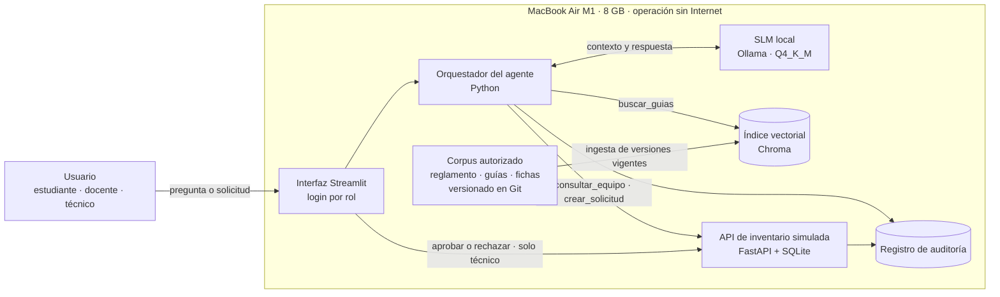

# Propuesta — Nueva sección 7. Arquitectura preliminar y decisión de procesamiento

> Borrador de la Sesión 3 para insertar en `Planteamiento_del_problema.md` después de la sección 6 (Alcance y delimitación). Las secciones siguientes se renumeran: 8. Requisitos, 9. Matriz de riesgos, 10. Criterios de éxito, 11. Conclusión. Supone provisionalmente el núcleo A (consulta de guías y registro de solicitudes de préstamo).

## 7. Arquitectura preliminar y decisión de procesamiento

Esta sección responde a la evidencia del Módulo 1 del diplomado, que exige una ficha de arquitectura y riesgo con decisión justificada sobre procesamiento local, híbrido o remoto, el diagnóstico de capacidades del equipo y el cálculo básico de requerimientos de memoria y almacenamiento de modelos cuantizados. La arquitectura se diseña para el equipo de menor capacidad disponible, de modo que, si opera en él, pueda reproducirse en cualquier estación de la ruta básica del diplomado.

### 7.1 Diagnóstico de hardware

| Componente | Valor | Observación |
|---|---|---|
| Equipo | MacBook Air (Apple M1) | Equipo de desarrollo y de demostración |
| CPU | Apple M1, 8 núcleos (4 de rendimiento y 4 de eficiencia) | — |
| GPU | Integrada en el M1, compatible con Metal | Número de núcleos: *Suposición por validar* |
| Memoria | 8 GB unificada, compartida por CPU, GPU y sistema operativo | Por debajo de los 16 GB recomendados para la ruta básica |
| Ancho de banda de memoria | ≈ 68 GB/s | Determina la velocidad de generación de tokens |
| Almacenamiento libre | *Suposición por validar* | Se requieren al menos 10–15 GB libres para modelos, entorno e índices |
| Sistema operativo | macOS (versión: *Suposición por validar*) | Ollama se ejecuta de forma nativa con aceleración Metal |
| Refrigeración | Pasiva (sin ventilador) | Posible reducción de rendimiento en sesiones prolongadas |
| Memoria ocupada por macOS y aplicaciones de trabajo | 3–4 GB estimados | *Suposición por validar*: medir en Monitor de Actividad |

La memoria unificada de 8 GB es la restricción principal. Excluye los modelos de 7B parámetros o más y la ejecución de herramientas en contenedores Docker, que en macOS no acceden a la GPU y consumen memoria adicional.

**Perfiles de hardware del equipo de trabajo.** Otros integrantes disponen de equipos con mayor memoria, que cumplen la ruta básica del diplomado. Se definen dos perfiles: un **perfil mínimo** (MacBook Air M1, 8 GB), sobre el que se valida que el sistema opera con el modelo seleccionado, y un **perfil de demostración**, correspondiente al equipo con mayor capacidad, en el que se ejecutará la sustentación y se evaluará el modelo alternativo. Ambos perfiles se documentarán en el benchmarking del Módulo 2.

| Integrante | Equipo | CPU | RAM | GPU / VRAM | Almacenamiento libre | Sistema operativo |
|---|---|---|---|---|---|---|
| Integrante 1 | MacBook Air M1 | Apple M1 (8 núcleos) | 8 GB unificada | Integrada (Metal) | *Por validar* | macOS (*por validar*) |
| Integrante 2 | *Por validar* | *Por validar* | *Por validar* | *Por validar* | *Por validar* | *Por validar* |
| Integrante 3 | *Por validar* | *Por validar* | *Por validar* | *Por validar* | *Por validar* | *Por validar* |

### 7.2 Selección del modelo de lenguaje y cálculo de memoria

El proyecto emplea un modelo de lenguaje pequeño (SLM) ejecutado localmente mediante Ollama en formato GGUF con cuantización Q4_K_M. La memoria requerida se estima como la suma de tres componentes: (a) los pesos del modelo, aproximadamente igual al número de parámetros multiplicado por los bits efectivos por peso (≈ 4,85 en Q4_K_M) y dividido entre 8; (b) la caché de claves y valores (KV cache), igual a 2 × capas × cabezas KV × dimensión de cabeza × longitud de contexto × 2 bytes en FP16; y (c) los búferes de ejecución del motor de inferencia. Se adopta una ventana de contexto de 4.096 tokens, suficiente para el mensaje del sistema, las definiciones de herramientas, cuatro fragmentos recuperados, el historial reciente y la respuesta.

| Concepto | Llama 3.2 3B Instruct | Qwen3-4B-Instruct-2507 |
|---|---|---|
| Parámetros | 3,21 × 10⁹ | 4,0 × 10⁹ |
| Cuantización | Q4_K_M | Q4_K_M |
| Pesos estimados (P × 4,85 / 8) | ≈ 1,95 GB | ≈ 2,4 GB |
| Tamaño real del archivo en Ollama | 2,0 GB | 2,5 GB |
| Capas / cabezas KV / dimensión de cabeza | 28 / 8 / 128 | 36 / 8 / 128 |
| KV cache por token (FP16) | 112 KiB | 144 KiB |
| KV cache con 4.096 tokens | ≈ 0,47 GB | ≈ 0,60 GB |
| Búferes de ejecución (*supuesto*) | ≈ 0,4 GB | ≈ 0,4 GB |
| **Subtotal del modelo** | **≈ 2,9 GB** | **≈ 3,5 GB** |
| Modelo de embeddings (qwen3-embedding 0,6B, Q8) | 0,64 GB | 0,64 GB |
| API, interfaz e índice vectorial (*supuesto*) | ≈ 0,4 GB | ≈ 0,4 GB |
| **Total de la pila de IA** | **≈ 3,9 GB** | **≈ 4,5 GB** |
| Margen sobre 8 GB con 3–4 GB del sistema | 0,1 a 1,1 GB | −0,5 a 0,5 GB |
| Velocidad máxima teórica (68 GB/s ÷ pesos) | ≈ 34 tokens/s | ≈ 27 tokens/s |
| Licencia | Llama 3.2 Community License | Apache 2.0 |
| Idioma español | Soportado oficialmente | Multilingüe; *a validar en pruebas* |
| Invocación de herramientas | Sí | Sí |

La velocidad máxima teórica se obtiene porque, en la generación de cada token, el motor debe leer todos los pesos desde memoria; la velocidad real suele ser bastante menor y deberá medirse (`ollama run <modelo> --verbose`, campo *eval rate*).

**Criterio de selección.** Llama 3.2 3B Instruct se propone como modelo principal por ofrecer margen de memoria en el equipo disponible. Qwen3-4B-Instruct-2507 se evaluará como alternativa, con las aplicaciones no esenciales cerradas, por su licencia más permisiva y su orientación a la invocación de herramientas. Qwen3 1.7B (1,4 GB en Q4_K_M) se reserva como respaldo si ninguno de los dos opera con estabilidad. La decisión final se tomará con el benchmarking del Módulo 2 sobre un conjunto fijo de tareas del caso: respuesta con cita, invocación correcta de herramientas y denegación de solicitudes fuera de permiso.

**Modelos descartados.** Los modelos de 7B–8B parámetros (≥ 4,7 GB en Q4_K_M) superan la memoria disponible junto con el sistema operativo. Qwen2.5-3B-Instruct se descarta por su licencia *qwen-research*, más restrictiva que la de los candidatos.

### 7.3 Decisión de procesamiento: local, híbrido o remoto

| Criterio | Local | Híbrido (modelo local, canal o servicio externo) | Remoto (modelo en la nube) |
|---|---|---|---|
| Datos del solicitante de un préstamo (Ley 1581 de 2012) | Permanecen en el equipo | Circulan por un tercero; exige autorización y evaluación | Se transfieren a un proveedor externo |
| Operación sin Internet (CS-10) | Sí | No | No |
| Costo de operación | Ninguno adicional | Depende del servicio | Pago por uso |
| Exigencia del diplomado (LLM/SLM local) | Cumple | Cumple si el modelo es local | Requiere excepción sustentada |
| Calidad del modelo | Limitada por 8 GB | Limitada por 8 GB | Mayor |
| Complejidad de integración | Baja | Media–alta | Media |

**Decisión:** procesamiento **local**. La totalidad de los componentes —interfaz, agente, modelo, índice documental, API de inventario y registros— se ejecuta en el equipo descrito en 7.1. La conexión a Internet se emplea únicamente durante la preparación del entorno para descargar modelos y paquetes. La menor calidad de un modelo pequeño se compensa con recuperación documental con citas, un número reducido de herramientas y validación de cada invocación en el orquestador y en la API. Un canal externo de mensajería queda fuera del alcance, porque convertiría la arquitectura en híbrida y obligaría a reformular RNF-03, CS-10 y R-06.

### 7.4 Componentes de la arquitectura

| Componente | Tecnología propuesta | Función |
|---|---|---|
| Interfaz de usuario | Streamlit | Chat para todos los roles; panel de solicitudes pendientes para el técnico |
| Autenticación | Cuentas locales con contraseña cifrada y rol (*Suposición por validar*) | Identificar al usuario y su rol en cada solicitud |
| Orquestador del agente | Python con la API de chat y herramientas de Ollama | Construir el contexto, validar y ejecutar las invocaciones permitidas |
| Modelo de lenguaje | Llama 3.2 3B Instruct, Q4_K_M, en Ollama | Interpretar la solicitud, decidir la herramienta y redactar la respuesta |
| Recuperación documental (RAG) | qwen3-embedding 0,6B + Chroma (persistente, local) | Recuperar fragmentos del corpus autorizado con su fuente y versión |
| API de inventario simulada | FastAPI + SQLite con datos sintéticos | Consultar equipos y registrar solicitudes; validar el rol en cada llamada |
| Registro de auditoría | Tabla SQLite de solo inserción | Conservar usuario, rol, herramienta, parámetros, resultado, aprobación y fecha |
| Componente multimodal | Por definir en la sección 6 (Sesión 4) | — |

El orquestador expone al modelo una lista cerrada de herramientas: `buscar_guias`, `consultar_equipo`, `crear_solicitud_prestamo` (crea la solicitud en estado *pendiente*), `consultar_mis_solicitudes` y `generar_reporte` (solo docente y coordinación). La aprobación de un préstamo no es una herramienta del agente: la realiza el técnico desde el panel de la interfaz, que invoca directamente la API. De este modo, la supervisión humana sobre las operaciones de escritura (RSG-04) queda garantizada por el diseño y no depende del comportamiento del modelo. Se prefiere un orquestador propio y breve sobre marcos como LangChain o LangGraph para reducir dependencias, consumo de memoria y superficie de la cadena de suministro (R-11); estos marcos se consideran alternativas equivalentes si el alcance crece.

### 7.5 Mapa de flujo de datos

| Dato | Origen → destino | ¿Sale del equipo? |
|---|---|---|
| Pregunta o solicitud del usuario | Usuario → interfaz → orquestador → modelo | No |
| Fragmentos de guías y reglamento | Índice vectorial → orquestador → modelo | No |
| Datos de equipos y solicitudes | API → orquestador → modelo / interfaz | No |
| Identificación del solicitante | Interfaz → API (SQLite) | No |
| Registros de auditoría | Orquestador y API → registro | No |
| Modelos y paquetes | Internet → equipo, solo en la preparación del entorno | Es una entrada única; no sale información del laboratorio |

### 7.6 Corpus del RAG

| Documento | Contenido | Formato | Aprobación | Origen |
|---|---|---|---|---|
| Reglamento de préstamo de equipos | Condiciones, plazos, devolución y responsabilidades | Markdown | Coordinación del laboratorio | Sintético, redactado por el equipo |
| Guías de práctica (3 a 5) | Objetivo, equipos requeridos, procedimiento y precauciones | Markdown o PDF | Docente responsable | Sintéticas o adaptadas de guías públicas con licencia compatible |
| Fichas técnicas de equipos (5 a 10) | Especificaciones, uso y cuidados | Markdown | Técnico de laboratorio | Sintéticas o tomadas de manuales públicos del fabricante |
| Normas de seguridad del laboratorio | Elementos de protección, prohibiciones y emergencias | Markdown | Coordinación del laboratorio | Sintéticas |

Cada documento incluirá un encabezado con identificador, versión, fecha, responsable de aprobación y estado (*vigente* u *obsoleto*); solo los documentos vigentes se indexan, y el historial se conserva en el repositorio Git. La fragmentación se realizará por sección del documento, de modo que cada cita remita a documento, versión y sección.

**RAG frente a ajuste fino.** Se adopta RAG y no ajuste fino del modelo por cuatro razones: el conocimiento del laboratorio cambia (reglamentos y versiones de guías) y debe actualizarse sin reentrenar; cada respuesta debe citar su fuente, lo que el ajuste fino no proporciona; el corpus es pequeño; y el equipo disponible no admite un entrenamiento eficiente con garantías. La recuperación aumentada separa el conocimiento, que reside en documentos versionados y auditables, de la capacidad lingüística del modelo (Lewis et al., 2020).

### 7.7 Interfaz y canal de interacción

La interacción se realiza mediante una aplicación web local en Streamlit, accesible desde el navegador del mismo equipo. Todos los roles disponen de una vista de conversación; el técnico dispone además de un panel con las solicitudes pendientes y los controles para aprobarlas o rechazarlas. Se descartan Open WebUI y AnythingLLM como interfaz final por su consumo de memoria en un equipo de 8 GB, y los canales externos de mensajería por las razones expuestas en 7.3.
