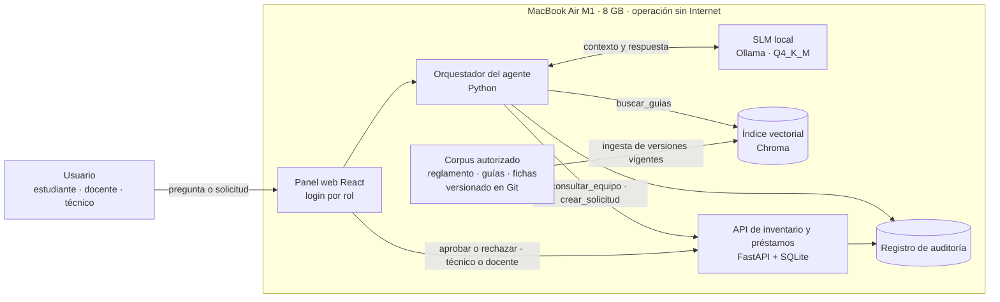

# Módulo 1. Planteamiento del problema

## 1. Introducción

Los laboratorios universitarios constituyen espacios fundamentales para el desarrollo de competencias prácticas en los procesos de formación profesional. En estos entornos, la ejecución de prácticas académicas requiere disponer de procedimientos claros, documentación técnica pertinente, recursos disponibles y mecanismos que permitan hacer seguimiento de las actividades desarrolladas. En el Diplomado en Inteligencia Artificial Generativa Local, Agentes Autónomos y Sistemas Multimodales (IA 5.0 Lab), estos elementos adquieren especial relevancia porque el programa concibe la inteligencia artificial no como una interfaz de conversación, sino como una infraestructura programable, evaluable y gobernable.

El proyecto integrador desarrolla uno de los casos que el propio diplomado propone como pertinentes para el proyecto final: un **agente técnico para un laboratorio universitario** que consulta guías, controla el inventario de práctica mediante una API y genera reportes, sin acceso general al sistema. La solución se concibe bajo un principio de autonomía limitada: el agente técnico opera únicamente sobre fuentes, herramientas, endpoints y permisos expresamente autorizados.

Esta delimitación responde a los principios de seguridad, trazabilidad, privacidad y supervisión humana del diplomado. El Módulo 3 establece que un agente no debe recibir acceso irrestricto al sistema, que la autonomía se entiende como una delegación limitada, observable y reversible, y que toda herramienta capaz de modificar datos requiere controles y aprobación humana en las acciones sensibles.

## 2. Contexto y situación problemática

El diplomado plantea que un agente no solo responde preguntas: puede mantener estado, consultar conocimiento, invocar funciones, llamar servicios y coordinar tareas. Protocolos como el Model Context Protocol (MCP) facilitan conectar modelos con recursos y herramientas, pero el propio documento advierte que esta capacidad introduce riesgos de acceso excesivo, ejecución no autorizada, *prompt injection* y exposición de información. Por ello, el programa incorpora los agentes junto con diseño de permisos, aislamiento, validación de entradas, supervisión humana, auditoría y principio de mínimo privilegio.

En el caso del laboratorio universitario, el proyecto identifica la necesidad de un mecanismo técnico que facilite la consulta de guías y procedimientos, permita consultar o gestionar la información del inventario de práctica mediante una interfaz controlada y genere reportes sobre información autorizada. El Módulo 3 establece como práctica la construcción de asistentes que consulten documentos, recuperen evidencia, citen fuentes y utilicen herramientas delimitadas, e incluye explícitamente un agente que usa una herramienta sin acceso general al sistema y un prototipo de integración con registro de cada invocación.

Las dificultades operativas que el proyecto busca atender incluyen la dispersión de guías y procedimientos en distintos documentos o sistemas, la consulta manual de la disponibilidad de recursos, las posibles inconsistencias en el seguimiento del inventario de práctica, la demora en la elaboración de reportes y la falta de trazabilidad sobre consultas y modificaciones.

**Suposición por validar:** el documento del diplomado no describe el procedimiento vigente del laboratorio ni cuantifica estas dificultades. Se presentan como situaciones plausibles que deberán confirmarse mediante levantamiento de información con los responsables del laboratorio. En la fase actual, el laboratorio es un escenario de referencia definido por el equipo y no un laboratorio institucional identificado; por ello, los datos del inventario son sintéticos.

El entorno del proyecto queda delimitado así: un laboratorio universitario, prácticas académicas, fuentes documentales y una API autorizada, usuarios autorizados con roles definidos, procesamiento local de la información y ausencia de acceso general al sistema institucional. El enfoque *local-first* del diplomado indica que los laboratorios deben poder ejecutarse sin conexión una vez preparado el entorno y que la información de los casos no debe abandonar la infraestructura de práctica cuando el ejercicio exija confidencialidad o control de datos. Esta delimitación es necesaria para proteger la información, reducir la posibilidad de acciones no autorizadas y conservar la supervisión humana.

En consecuencia, el problema no consiste únicamente en crear una interfaz conversacional; el diplomado señala que no se aceptará como producto final una simple interfaz que envíe *prompts* a un modelo. El desafío es diseñar un agente técnico que apoye las actividades del laboratorio sin convertir su capacidad de automatización en un mecanismo de acceso indiscriminado a información o sistemas institucionales.

**Decisión de diseño:** el escenario no cuenta con un sistema de inventario que exponga una API, por lo que el equipo construye la API autorizada de inventario y préstamos, con sus endpoints y roles (sección 7.4). La estructura de las guías se define en el corpus del RAG (sección 7.6). *Suposición por validar:* los roles institucionales definitivos deberán confirmarse con los responsables del laboratorio.

## 3. Planteamiento del problema

En un laboratorio universitario, la realización de prácticas académicas requiere que los usuarios dispongan de información sobre procedimientos, guías y recursos disponibles. Cuando esta información se encuentra distribuida en diferentes documentos o sistemas, aumenta la complejidad de su consulta y se dificulta la obtención de respuestas contextualizadas. De manera complementaria, la información del inventario de práctica requiere mecanismos de consulta y actualización que conserven su consistencia y trazabilidad.

La situación afecta a estudiantes o practicantes, que necesitan información confiable para ejecutar sus prácticas; a docentes, que orientan y supervisan dichas prácticas; al personal técnico, que gestiona los recursos y el inventario; y a los responsables administrativos o técnicos del laboratorio, que requieren reportes para el seguimiento de la operación. Las capacidades de cada actor deben diferenciarse mediante autenticación y autorización: la solución no debe asumir que un usuario que puede consultar una guía posee automáticamente autorización para modificar el inventario de práctica.

Las prácticas basadas en consulta manual y documentación dispersa resultan insuficientes porque dependen de la disponibilidad de personas concretas, dificultan verificar qué versión de una guía es vigente y no siempre dejan registro de quién consultó o modificó la información. A la vez, la incorporación de un agente sin restricciones podría producir consecuencias igualmente indeseables: respuestas basadas en información incorrecta o desactualizada, modificaciones no autorizadas del inventario, pérdida de trazabilidad, exposición de información y dependencia excesiva de las respuestas generadas. El diplomado identifica como riesgos de las aplicaciones generativas el *prompt injection*, la fuga de datos, el uso indebido de herramientas (*tool misuse*), los permisos excesivos y la cadena de suministro de modelos y dependencias.

El proyecto propone atender esta situación mediante un agente técnico ejecutado sobre un modelo de lenguaje local, capaz de consultar fuentes documentales autorizadas, acceder al inventario de práctica exclusivamente mediante una API autorizada y generar reportes a partir de información disponible y verificable. El enfoque RAG del diplomado resulta pertinente porque busca aplicaciones que citen fuentes, controlen el contexto y reduzcan las respuestas no sustentadas. El agente técnico debe entenderse como un componente de apoyo y no como un sustituto de las responsabilidades humanas: su autonomía será limitada, observable y reversible, en particular cuando una operación pueda modificar información o requiera aprobación.

La pregunta problema que orienta el proyecto es:

> **¿Cómo diseñar e implementar un agente técnico para un laboratorio universitario que consulte guías y procedimientos autorizados, apoye las solicitudes de préstamo y demás procedimientos autorizados, interactúe con el inventario de práctica mediante una API autorizada y genere reportes trazables, manteniendo límites de acceso, controles de seguridad y supervisión humana sobre las operaciones sensibles?**

## 4. Justificación

### 4.1 Justificación académica

El proyecto permite aplicar de manera integrada las competencias del diplomado sobre IA local, RAG, agentes, generación verificable de código, evaluación y gobernanza. El Módulo 8 exige como componentes mínimos del proyecto integrador: problema, usuarios, alcance, requisitos y criterio de éxito; arquitectura local o híbrida justificada; un LLM o SLM ejecutado localmente; una base de conocimiento RAG con citas; un agente con al menos una herramienta controlada; una aplicación o API funcional con código versionado; un componente multimodal; un plan de evaluación; una matriz de riesgos, privacidad, licencias y seguridad; documentación de operación local-first; y una demostración con sustentación técnica. Este módulo establece la base de esos componentes; la definición del problema, los usuarios y los requisitos representa el 10 % de la rúbrica del proyecto integrador.

### 4.2 Justificación operativa

La integración de consultas documentales, información del inventario de práctica y generación de reportes puede proporcionar un punto único de apoyo a las actividades del laboratorio. Centralizar las consultas autorizadas puede mejorar la disponibilidad de información para las prácticas, apoyar el control del inventario y estandarizar el formato de los reportes, siempre que las operaciones estén condicionadas por los permisos establecidos.

### 4.3 Justificación tecnológica

El proyecto permite aplicar una arquitectura local o híbrida que combine modelos locales, una base de conocimiento RAG y herramientas controladas. Según el diplomado, ejecutar modelos en infraestructura propia permite trabajar con información sensible sin transferirla necesariamente a terceros, operar con conectividad limitada y controlar versiones y dependencias. El criterio de calidad del proyecto integrador favorece una solución pequeña y reproducible que opere de manera confiable en el hardware disponible sobre una demostración dependiente de recursos inaccesibles o servicios no controlados.

### 4.4 Justificación de seguridad y gobierno

El mínimo privilegio, la trazabilidad y la supervisión humana son condiciones de valor del proyecto y no obstáculos. Un agente técnico que solo accede a lo necesario reduce la superficie de error y de ataque; un agente cuyas acciones quedan registradas puede auditarse y corregirse; y un agente que escala las operaciones sensibles a un responsable humano preserva la rendición de cuentas institucional. El proyecto se alinea, además, con los referentes que adopta el diplomado: el eje de prevención de riesgos del CONPES 4144 (DNP, 2025), las funciones del NIST AI RMF (NIST, 2023, 2024), los principios de la UNESCO (2021) y la Ley 1581 de 2012 sobre protección de datos personales (Congreso de Colombia, 2012).

## 5. Usuarios y partes interesadas

| Actor | Rol o necesidad | Interacción permitida con el agente | Información o acción autorizada | Restricción o responsabilidad |
|---|---|---|---|---|
| Estudiantes o practicantes autorizados | Consultar información para desarrollar prácticas | Consulta de guías, procedimientos y disponibilidad; registro de solicitudes de préstamo | Guías vigentes y disponibilidad del inventario de práctica | No pueden modificar el inventario; sus solicitudes requieren aprobación de un responsable |
| Docentes responsables de práctica | Orientar y supervisar prácticas | Consultas, generación de reportes de sus prácticas y aprobación de solicitudes | Guías, información de sus prácticas y reportes | Validar las solicitudes y acciones que requieran aprobación en su ámbito |
| Técnicos o auxiliares de laboratorio | Gestionar recursos e inventario | Consultas y operaciones de inventario según rol | Registro de entradas, salidas y préstamos por API autorizada | Responder por las operaciones ejecutadas; confirmar actualizaciones sensibles |
| Coordinación o administración del laboratorio | Supervisar la operación | Consulta de reportes e indicadores | Reportes consolidados e indicadores | Aprobar decisiones administrativas; no delegar en el agente decisiones de compra o sanción |
| Administrador de la API o sistema de inventario | Administrar la integración técnica | Configuración de endpoints y credenciales, fuera del canal conversacional | Permisos, credenciales y disponibilidad del servicio | Mantener autenticación, autorización y revocación de credenciales; no exponer secretos en repositorios o *prompts* |
| Equipo responsable del proyecto | Diseñar, implementar y evaluar | Administración técnica en entorno de desarrollo y pruebas | Configuración, datos de prueba y documentación | No ampliar permisos fuera del alcance aprobado; usar datos sintéticos, anonimizados o autorizados |

**Suposición por validar:** la asignación de la aprobación de préstamos a docentes y técnicos se propone por coherencia con sus funciones; el reglamento del laboratorio deberá confirmarla.

La clasificación distingue tres tipos de actores. Los **usuarios finales** (estudiantes, docentes en su función de consulta y coordinación) utilizan las capacidades habilitadas para su rol. Los **responsables de aprobación** (docentes, técnicos y coordinación) intervienen en las operaciones sensibles y responden por ellas. Los **responsables técnicos** (administrador de la API y equipo del proyecto) administran la infraestructura, las integraciones, los permisos y los mecanismos de auditoría, sin intervenir en las decisiones académicas. El diplomado prevé que el proyecto se desarrolle en equipos de dos a cuatro estudiantes con responsabilidades técnicas diferenciadas.

## 6. Alcance y delimitación

### 6.1 Alcance funcional incluido

El sistema propuesto incluirá:

- Consulta de guías y procedimientos autorizados mediante RAG, con referencia a la fuente y a la versión disponible.
- Ejecución del modelo de lenguaje (LLM o SLM) en infraestructura local, salvo excepción técnica debidamente sustentada.
- Consulta del inventario de práctica mediante la API autorizada.
- Actualización del inventario de práctica y registro de solicitudes de préstamo únicamente cuando el rol, la operación y la confirmación requerida lo permitan.
- Generación de reportes basados en información autorizada, con indicación del origen de los datos.
- Registro de solicitudes, respuestas, invocaciones de herramientas, errores, denegaciones y aprobaciones.
- Escalamiento a un responsable humano cuando una solicitud esté fuera del alcance, fuera de permiso o requiera aprobación.
- Un componente multimodal seleccionado por pertinencia, como exige el proyecto integrador.

### 6.2 Exclusiones

El proyecto no contempla:

- Acceso general a sistemas institucionales.
- Consulta o tratamiento de datos personales que no sean necesarios para la operación.
- Envío de información sensible del laboratorio a servicios externos sin autorización explícita y evaluación previa.
- Modificación de configuraciones críticas.
- Toma autónoma de decisiones académicas, de seguridad o de compra.
- Ejecución de operaciones irreversibles sin validación humana.
- Uso de fuentes no autorizadas como si fueran oficiales.
- Ampliación automática de privilegios del agente técnico.
- Canales externos de mensajería (por ejemplo, WhatsApp) en el producto mínimo demostrable, porque convertirían la arquitectura en híbrida (sección 7.3).

### 6.3 Límites operativos y supuestos por validar

- **Permisos:** el agente técnico actuará con credenciales propias de mínimo privilegio y con los permisos del usuario autorizado que realiza la solicitud, sin superar ninguno de los dos. El agente estará aislado, con directorios, comandos, redes y credenciales limitados, conforme a las recomendaciones del diplomado. *Suposición por validar:* el modelo de delegación de permisos deberá definirse en el diseño.
- **Disponibilidad de la API:** el agente dependerá de la disponibilidad y calidad de la API. Una falla del servicio no deberá llevarlo a inventar disponibilidad, resultados ni confirmaciones; deberá informar el error y, si corresponde, escalar.
- **Calidad de las guías:** la exactitud de las respuestas dependerá de que las guías estén vigentes y versionadas. Los documentos del RAG se tratarán como activos de información: se clasifican, autorizan, respaldan y eliminan de manera controlada. *Suposición por validar:* se requiere un responsable del repositorio documental autorizado.
- **Datos:** durante el desarrollo se emplearán datos públicos, sintéticos, anonimizados o expresamente autorizados, como dispone el diplomado. *Suposición por validar:* la necesidad de tratar datos personales reales (por ejemplo, el solicitante de un préstamo) deberá evaluarse frente a la Ley 1581 de 2012.
- **Autenticación:** el producto mínimo emplea cuentas locales del laboratorio con contraseña cifrada, rol asignado y token de sesión (sección 7.4). *Suposición por validar:* la integración con el directorio institucional queda fuera del alcance actual y deberá evaluarse con el área técnica.
- **Auditoría:** los registros deberán conservar usuario, fecha, operación, resultado y aprobación asociada. *Suposición por validar:* el tiempo de retención y su ubicación deberán definirse.
- **Revisión humana:** *Suposición por validar:* el catálogo de operaciones sensibles que exigirán confirmación deberá acordarse con los responsables del laboratorio.
- **Solicitudes de préstamo:** el caso de referencia del diplomado menciona guías, inventario y reportes; el flujo de préstamos se incorpora por necesidad del laboratorio y se define con los estados pendiente, aprobado, entregado y devuelto, además de rechazado y cancelado. *Suposición por validar:* el procedimiento deberá contrastarse con el reglamento real del laboratorio.
- **Componente multimodal:** *Suposición por validar:* el diplomado lo exige sin precisarlo para este caso; podrían considerarse, por ejemplo, el OCR de guías escaneadas o el reconocimiento visual de equipos, según su pertinencia y el hardware disponible.
- **Hardware:** el modelo local se selecciona según la capacidad real del equipo disponible; el diagnóstico y el cálculo de memoria se presentan en la sección 7.
- **Gestión de errores:** ante entradas ambiguas, permisos insuficientes o confianza insuficiente en la respuesta, el agente deberá denegar o escalar en lugar de ejecutar.

## 7. Arquitectura preliminar y decisión de procesamiento

Esta sección responde a la evidencia del Módulo 1 del diplomado, que exige una ficha de arquitectura y riesgo con decisión justificada sobre procesamiento local, híbrido o remoto, el diagnóstico de capacidades del equipo y el cálculo básico de requerimientos de memoria y almacenamiento de modelos cuantizados. La arquitectura se diseña para el equipo de menor capacidad disponible, de modo que, si opera en él, pueda reproducirse en cualquier estación de la ruta básica del diplomado.

### 7.1 Diagnóstico de hardware

| Componente | Valor | Observación |
|---|---|---|
| Equipo | MacBook Air (Apple M1) | Equipo de desarrollo y de demostración |
| CPU | Apple M1, 8 núcleos (4 de rendimiento y 4 de eficiencia) | — |
| GPU | Integrada en el M1, compatible con Metal | Número de núcleos: *Suposición por validar* |
| Memoria | 8 GB unificada, compartida por CPU, GPU y sistema operativo | Por debajo de los 16 GB recomendados para la ruta básica |
| Ancho de banda de memoria | ≈ 68 GB/s | Determina la velocidad de generación de tokens |
| Almacenamiento libre | *Suposición por validar* | Se requieren al menos 10–15 GB libres para modelos, entorno e índices |
| Sistema operativo | macOS (versión: *Suposición por validar*) | Ollama se ejecuta de forma nativa con aceleración Metal |
| Refrigeración | Pasiva (sin ventilador) | Posible reducción de rendimiento en sesiones prolongadas |
| Memoria ocupada por macOS y aplicaciones de trabajo | 3–4 GB estimados | *Suposición por validar*: medir en Monitor de Actividad |

La memoria unificada de 8 GB es la restricción principal. Excluye los modelos de 7B parámetros o más y el uso de contenedores Docker en este equipo, que en macOS no acceden a la GPU y consumen memoria adicional. Por ello, en el perfil mínimo la API se ejecuta con SQLite y sin Docker; la configuración con PostgreSQL en Docker se reserva para los equipos con más memoria o para el servidor del laboratorio.

**Perfiles de hardware del equipo de trabajo.** Otros integrantes disponen de equipos con mayor memoria, que cumplen la ruta básica del diplomado. Se definen dos perfiles: un **perfil mínimo** (MacBook Air M1, 8 GB), sobre el que se valida que el sistema opera con el modelo seleccionado, y un **perfil de demostración**, correspondiente al equipo con mayor capacidad, en el que se ejecutará la sustentación y se evaluará el modelo alternativo. Ambos perfiles se documentarán en el benchmarking del Módulo 2.

| Integrante | Equipo | CPU | RAM | GPU / VRAM | Almacenamiento libre | Sistema operativo |
|---|---|---|---|---|---|---|
| Integrante 1 | MacBook Air M1 | Apple M1 (8 núcleos) | 8 GB unificada | Integrada (Metal) | *Por validar* | macOS (*por validar*) |
| Integrante 2 | *Por validar* | *Por validar* | *Por validar* | *Por validar* | *Por validar* | *Por validar* |
| Integrante 3 | *Por validar* | *Por validar* | *Por validar* | *Por validar* | *Por validar* | *Por validar* |

### 7.2 Selección del modelo de lenguaje y cálculo de memoria

El proyecto emplea un modelo de lenguaje pequeño (SLM) ejecutado localmente mediante Ollama en formato GGUF con cuantización Q4_K_M. La memoria requerida se estima como la suma de tres componentes: (a) los pesos del modelo, aproximadamente igual al número de parámetros multiplicado por los bits efectivos por peso (≈ 4,85 en Q4_K_M) y dividido entre 8; (b) la caché de claves y valores (KV cache), igual a 2 × capas × cabezas KV × dimensión de cabeza × longitud de contexto × 2 bytes en FP16; y (c) los búferes de ejecución del motor de inferencia. Se adopta una ventana de contexto de 4.096 tokens, suficiente para el mensaje del sistema, las definiciones de herramientas, cuatro fragmentos recuperados, el historial reciente y la respuesta.

| Concepto | Llama 3.2 3B Instruct | Qwen3-4B-Instruct-2507 |
|---|---|---|
| Parámetros | 3,21 × 10⁹ | 4,0 × 10⁹ |
| Cuantización | Q4_K_M | Q4_K_M |
| Pesos estimados (P × 4,85 / 8) | ≈ 1,95 GB | ≈ 2,4 GB |
| Tamaño real del archivo en Ollama | 2,0 GB | 2,5 GB |
| Capas / cabezas KV / dimensión de cabeza | 28 / 8 / 128 | 36 / 8 / 128 |
| KV cache por token (FP16) | 112 KiB | 144 KiB |
| KV cache con 4.096 tokens | ≈ 0,47 GB | ≈ 0,60 GB |
| Búferes de ejecución (*supuesto*) | ≈ 0,4 GB | ≈ 0,4 GB |
| **Subtotal del modelo** | **≈ 2,9 GB** | **≈ 3,5 GB** |
| Modelo de embeddings (qwen3-embedding 0,6B, Q8) | 0,64 GB | 0,64 GB |
| API, interfaz e índice vectorial (*supuesto*) | ≈ 0,4 GB | ≈ 0,4 GB |
| **Total de la pila de IA** | **≈ 3,9 GB** | **≈ 4,5 GB** |
| Margen sobre 8 GB con 3–4 GB del sistema | 0,1 a 1,1 GB | −0,5 a 0,5 GB |
| Velocidad máxima teórica (68 GB/s ÷ pesos) | ≈ 34 tokens/s | ≈ 27 tokens/s |
| Licencia | Llama 3.2 Community License | Apache 2.0 |
| Idioma español | Soportado oficialmente | Multilingüe; *a validar en pruebas* |
| Invocación de herramientas | Sí | Sí |

La velocidad máxima teórica se obtiene porque, en la generación de cada token, el motor debe leer todos los pesos desde memoria; la velocidad real suele ser bastante menor y deberá medirse (`ollama run <modelo> --verbose`, campo *eval rate*).

**Criterio de selección.** Llama 3.2 3B Instruct se propone como modelo principal por ofrecer margen de memoria en el equipo disponible. Qwen3-4B-Instruct-2507 se evaluará como alternativa, con las aplicaciones no esenciales cerradas, por su licencia más permisiva y su orientación a la invocación de herramientas. Qwen3 1.7B (1,4 GB en Q4_K_M) se reserva como respaldo si ninguno de los dos opera con estabilidad. La decisión final se tomará con el benchmarking del Módulo 2 sobre un conjunto fijo de tareas del caso: respuesta con cita, invocación correcta de herramientas y denegación de solicitudes fuera de permiso.

**Modelos descartados.** Los modelos de 7B–8B parámetros (≥ 4,7 GB en Q4_K_M) superan la memoria disponible junto con el sistema operativo. Qwen2.5-3B-Instruct se descarta por su licencia *qwen-research*, más restrictiva que la de los candidatos.

### 7.3 Decisión de procesamiento: local, híbrido o remoto

| Criterio | Local | Híbrido (modelo local, canal o servicio externo) | Remoto (modelo en la nube) |
|---|---|---|---|
| Datos del solicitante de un préstamo (Ley 1581 de 2012) | Permanecen en el equipo | Circulan por un tercero; exige autorización y evaluación | Se transfieren a un proveedor externo |
| Operación sin Internet (CS-10) | Sí | No | No |
| Costo de operación | Ninguno adicional | Depende del servicio | Pago por uso |
| Exigencia del diplomado (LLM/SLM local) | Cumple | Cumple si el modelo es local | Requiere excepción sustentada |
| Calidad del modelo | Limitada por 8 GB | Limitada por 8 GB | Mayor |
| Complejidad de integración | Baja | Media–alta | Media |

**Decisión:** procesamiento **local**. La totalidad de los componentes —interfaz, agente, modelo, índice documental, API de inventario y registros— se ejecuta en el equipo descrito en 7.1. La conexión a Internet se emplea únicamente durante la preparación del entorno para descargar modelos y paquetes. La menor calidad de un modelo pequeño se compensa con recuperación documental con citas, un número reducido de herramientas y validación de cada invocación en el orquestador y en la API. Un canal externo de mensajería, como WhatsApp, queda fuera del producto mínimo porque convertiría la arquitectura en híbrida y obligaría a reformular RNF-03, CS-10 y R-06; se registra como mejora futura.

### 7.4 Componentes de la arquitectura

| Componente | Tecnología | Función | Estado |
|---|---|---|---|
| Interfaz de usuario | Panel web en React + Vite, sin librerías de interfaz ni fuentes remotas | Pantallas por rol (inventario, préstamos, reportes, auditoría y usuarios) y vista de conversación con el agente | Panel implementado; vista de conversación pendiente |
| Autenticación | Cuentas locales con contraseña cifrada (PBKDF2-SHA256), rol asignado y token JWT; bloqueo temporal tras intentos fallidos | Identificar al usuario y su rol en cada solicitud | Implementada |
| Orquestador del agente | Python con la API de chat y herramientas de Ollama | Construir el contexto, validar y ejecutar las invocaciones permitidas | Pendiente |
| Modelo de lenguaje | Llama 3.2 3B Instruct, Q4_K_M, en Ollama | Interpretar la solicitud, decidir la herramienta y redactar la respuesta | Seleccionado; pendiente del benchmarking del Módulo 2 |
| Recuperación documental (RAG) | qwen3-embedding 0,6B + Chroma (persistente, local) | Recuperar fragmentos del corpus autorizado con su fuente y versión | Pendiente |
| API de inventario y préstamos | FastAPI + SQLAlchemy; SQLite en desarrollo y PostgreSQL en el servidor; datos sintéticos | Consultar el inventario, registrar movimientos y gestionar el ciclo del préstamo; validar el rol en cada llamada | Implementada, con pruebas automatizadas |
| Registro de auditoría | Tabla de auditoría de la API | Conservar usuario, canal, operación, resultado, identificador de la petición y fecha, incluidas las denegaciones y los errores | Implementado en la API; falta registrar las invocaciones del agente |
| Componente multimodal | Por definir (sección 6.3) | — | Pendiente |

El orquestador expone al modelo una lista cerrada de herramientas: `buscar_guias`, `consultar_equipo`, `crear_solicitud_prestamo` (crea la solicitud en estado *pendiente*), `consultar_mis_solicitudes` y `generar_reporte` (solo para los roles con permiso de reportes en la API). La aprobación de un préstamo no es una herramienta del agente: la realiza el técnico o el docente responsable de la práctica desde el panel web, que invoca directamente la API, y nadie puede aprobar su propia solicitud. De este modo, la supervisión humana sobre las operaciones de escritura (RSG-04) queda garantizada por el diseño y no depende del comportamiento del modelo. Se prefiere un orquestador propio y breve sobre marcos como LangChain o LangGraph para reducir dependencias, consumo de memoria y superficie de la cadena de suministro (R-11); estos marcos se consideran alternativas equivalentes si el alcance crece.

### 7.5 Mapa de flujo de datos

| Dato | Origen → destino | ¿Sale del equipo? |
|---|---|---|
| Pregunta o solicitud del usuario | Usuario → interfaz → orquestador → modelo | No |
| Fragmentos de guías y reglamento | Índice vectorial → orquestador → modelo | No |
| Datos de equipos y solicitudes | API → orquestador → modelo / interfaz | No |
| Identificación del solicitante | Interfaz → API (SQLite) | No |
| Registros de auditoría | Orquestador y API → registro | No |
| Modelos y paquetes | Internet → equipo, solo en la preparación del entorno | Es una entrada única; no sale información del laboratorio |

### 7.6 Corpus del RAG

| Documento | Contenido | Formato | Aprobación | Origen |
|---|---|---|---|---|
| Reglamento de préstamo de equipos | Condiciones, plazos, devolución y responsabilidades | Markdown | Coordinación del laboratorio | Sintético, redactado por el equipo |
| Guías de práctica (3 a 5) | Objetivo, equipos requeridos, procedimiento y precauciones | Markdown o PDF | Docente responsable | Sintéticas o adaptadas de guías públicas con licencia compatible |
| Fichas técnicas de equipos (5 a 10) | Especificaciones, uso y cuidados | Markdown | Técnico de laboratorio | Sintéticas o tomadas de manuales públicos del fabricante |
| Normas de seguridad del laboratorio | Elementos de protección, prohibiciones y emergencias | Markdown | Coordinación del laboratorio | Sintéticas |

Cada documento incluirá un encabezado con identificador, versión, fecha, responsable de aprobación y estado (*vigente* u *obsoleto*); solo los documentos vigentes se indexan, y el historial se conserva en el repositorio Git. La fragmentación se realizará por sección del documento, de modo que cada cita remita a documento, versión y sección.

**RAG frente a ajuste fino.** Se adopta RAG y no ajuste fino del modelo por cuatro razones: el conocimiento del laboratorio cambia (reglamentos y versiones de guías) y debe actualizarse sin reentrenar; cada respuesta debe citar su fuente, lo que el ajuste fino no proporciona; el corpus es pequeño; y el equipo disponible no admite un entrenamiento eficiente con garantías. La recuperación aumentada separa el conocimiento, que reside en documentos versionados y auditables, de la capacidad lingüística del modelo (Lewis et al., 2020).

### 7.7 Interfaz y canal de interacción

La interacción se realiza mediante un panel web local desarrollado en React y Vite, que funciona sin Internet una vez instalado porque no depende de librerías de interfaz ni de fuentes remotas. Cada rol ve únicamente las pantallas y acciones que le corresponden, aunque la autorización se valida siempre en la API. El técnico y el docente responsable disponen de bandejas con las solicitudes por aprobar y de los controles para aprobarlas o rechazarlas. La vista de conversación con el agente se incorporará al mismo panel. Streamlit, considerado en la propuesta inicial, se reemplazó por este panel (véase el registro de decisiones del repositorio). Open WebUI y AnythingLLM se descartan como interfaz final por su consumo de memoria en un equipo de 8 GB, y los canales externos de mensajería quedan como mejora futura por las razones expuestas en 7.3.

## 8. Requisitos del sistema

| ID | Tipo | Requisito | Prioridad | Criterio de verificación | Relación con el riesgo |
|---|---|---|---|---|---|
| RF-01 | Funcional | Consultar guías autorizadas y comunicar la fuente o versión utilizada | Alta | Casos de prueba con preguntas sobre guías conocidas; cada respuesta indica fuente y versión | R-01, R-02 |
| RF-02 | Funcional | Consultar el inventario de práctica mediante endpoints de la API autorizada | Alta | Pruebas de consulta con permisos válidos; solo se invocan endpoints de la lista permitida | R-03 |
| RF-03 | Funcional | Ejecutar actualizaciones de inventario y registrar solicitudes de préstamo solo si el rol, la operación y la confirmación requerida lo permiten | Alta | Pruebas positivas y negativas por rol; operaciones sin confirmación no se ejecutan | R-03, R-04 |
| RF-04 | Funcional | Generar reportes trazables a partir de información autorizada | Alta | Revisión de reportes: cada dato remite a su origen y momento de consulta | R-07 |
| RF-05 | Funcional | Derivar al responsable humano las solicitudes fuera de alcance o de confianza insuficiente | Alta | Casos de prueba con solicitudes no permitidas o ambiguas; se registran como escaladas | R-08 |
| RNF-01 | No funcional | Ofrecer respuestas comprensibles y conservar trazabilidad de las acciones relevantes | Alta | Revisión de respuestas por usuarios de prueba y verificación cruzada con registros | R-07 |
| RNF-02 | No funcional | Manejar fallos de la API sin inventar disponibilidad, resultados ni confirmaciones | Alta | Simulación de caída, latencia y respuestas inválidas de la API | R-05 |
| RNF-03 | No funcional | Operar con un modelo local y sin enviar información del laboratorio a servicios externos | Alta | Ejecución sin conexión a Internet tras preparar el entorno; revisión de tráfico de red | R-06 |
| RSG-01 | Seguridad/gobierno | Aplicar mínimo privilegio, autenticación, autorización por rol y aislamiento del agente | Alta | Pruebas de permisos por rol; verificación de directorios, comandos, redes y credenciales accesibles | R-03, R-10 |
| RSG-02 | Seguridad/gobierno | No acceder, inferir ni revelar información fuera de las fuentes y permisos autorizados | Alta | Pruebas de extracción y de fuga de información | R-06, R-09 |
| RSG-03 | Seguridad/gobierno | Registrar eventos, invocaciones de herramientas, errores, denegaciones y aprobaciones para auditoría | Alta | Inspección de registros frente a un guion de operaciones de prueba | R-07 |
| RSG-04 | Seguridad/gobierno | Exigir supervisión o aprobación humana en operaciones definidas como sensibles o irreversibles | Alta | Pruebas de confirmación: ninguna operación sensible se completa sin aprobación registrada | R-04, R-08 |
| RSG-05 | Seguridad/gobierno | Tratar el contenido de documentos y entradas como datos, no como instrucciones | Alta | Pruebas de *prompt injection* con documentos adversariales | R-09 |
| RSG-06 | Seguridad/gobierno | Registrar versión, fuente, licencia y hash de modelos y dependencias, y no almacenar secretos en repositorios | Media | Revisión del manifiesto de modelos y escaneo del repositorio | R-11 |

Estos requisitos constituyen condiciones de aceptación del sistema. Su estado de implementación y las pruebas que los verifican se registran en el documento de trazabilidad del repositorio (`docs/03_trazabilidad.md`).

## 9. Matriz de riesgos — NIST AI RMF

El diplomado adopta el NIST AI Risk Management Framework 1.0 como referente operativo y el perfil NIST AI 600-1 para los riesgos propios de la IA generativa (NIST, 2023, 2024). La matriz se organiza según sus cuatro funciones: **GOVERN, MAP, MEASURE y MANAGE**. GOVERN establece responsabilidades y políticas de manera transversal a todo el ciclo de vida; MAP contextualiza el sistema, sus usuarios, datos, impactos, amenazas y dependencias; MEASURE evalúa los riesgos mediante pruebas y métricas; y MANAGE prioriza e implementa su tratamiento mediante mitigaciones, límites de autonomía, controles, *rollback*, monitoreo y mejora. Cada riesgo se asigna a la función desde la cual se gestiona principalmente, aunque todos atraviesan las cuatro.

**Escala de valoración.** Probabilidad: *Baja* (poco esperable en la operación normal), *Media* (puede presentarse ocasionalmente), *Alta* (esperable sin controles). Nivel inherente y riesgo residual: *Bajo*, *Medio* o *Alto*, según la combinación de probabilidad e impacto antes y después de aplicar los controles previstos.

| ID | Función NIST AI RMF | Riesgo o escenario | Causa o fuente | Impacto potencial | Probabilidad | Nivel inherente | Controles o mitigación | Evidencia / métrica de seguimiento | Riesgo residual | Responsable |
|---|---|---|---|---|---|---|---|---|---|---|
| R-01 | MEASURE | Respuesta inexacta, desactualizada o no sustentada (alucinación) | Guías desactualizadas o recuperación deficiente | Errores en la ejecución de prácticas | Media | Alto | Recuperación limitada a fuentes autorizadas; citación obligatoria de fuente y versión; respuesta "no encontrado" cuando no hay evidencia | % de respuestas con fuente autorizada identificable | Medio | Equipo del proyecto |
| R-02 | GOVERN | Uso de fuente no autorizada o confusión entre versiones | Repositorio sin control de versiones o configuración inadecuada | Información no oficial presentada como vigente | Media | Alto | Lista de fuentes permitidas; versionado; documentos clasificados y autorizados | Auditoría periódica de fuentes indexadas | Bajo | Responsable técnico |
| R-03 | MAP | Acceso indebido o privilegios excedentes en la API | Credenciales con permisos superiores a los necesarios | Consulta o modificación indebida del inventario | Media | Alto | Mínimo privilegio; lista de endpoints permitidos; autorización por rol; aislamiento del agente | Resultados de pruebas de autorización por rol | Medio | Administrador de la API |
| R-04 | MANAGE | Actualización errónea, duplicada o no autorizada del inventario | Error del agente, del usuario o reintentos automáticos | Inventario inconsistente | Media | Alto | Validación de entradas; confirmación humana; operaciones idempotentes; *rollback* | Casos de prueba de actualización; incidencias registradas | Medio | Técnico de laboratorio |
| R-05 | MEASURE | Caída, latencia o respuesta inconsistente de la API | Falla del servicio o de la red | Información incompleta o retrasos | Media | Medio | Manejo seguro de errores; tiempos de espera; prohibición de completar datos faltantes | % de fallos reportados correctamente | Bajo | Responsable técnico |
| R-06 | GOVERN | Divulgación de información sensible o datos personales no necesarios | Permisos o fuentes mal configurados; envío a servicios externos | Pérdida de confidencialidad; incumplimiento de la Ley 1581 de 2012 | Baja | Alto | Control de acceso; minimización de datos; procesamiento local; datos sintéticos o anonimizados en pruebas | Resultados de pruebas de fuga de información | Medio | Responsable de seguridad |
| R-07 | MEASURE | Falta de trazabilidad o explicabilidad | Registros incompletos | Imposibilidad de auditar o corregir | Media | Alto | Registro de eventos, invocaciones, denegaciones y aprobaciones | Cobertura de registros de auditoría | Bajo | Equipo del proyecto |
| R-08 | MANAGE | Dependencia excesiva del agente o ausencia de revisión humana | Confianza no calibrada de los usuarios | Decisiones incorrectas sin revisión | Media | Alto | Escalamiento obligatorio; aprobación humana en operaciones sensibles; formación de usuarios | Tasa de escalamiento; revisión de casos aprobados | Medio | Docente / responsable de laboratorio |
| R-09 | MAP | *Prompt injection*, *tool misuse* o intento de eludir restricciones | Documento o entrada maliciosa | Ejecución de acciones no autorizadas | Media | Alto | Contenido tratado como datos; aislamiento de herramientas; validación de entradas; pruebas adversariales | Resultados de *red teaming* académico | Medio | Responsable de seguridad |
| R-10 | GOVERN | Tratamiento desigual en el acceso, la respuesta o el escalamiento | Reglas o permisos inconsistentes entre roles o usuarios | Atención desigual a usuarios autorizados | Baja | Medio | Revisión de reglas por rol; casos de prueba equivalentes entre perfiles | Pruebas comparativas por perfil | Bajo | Equipo del proyecto |
| R-11 | MAP | Compromiso de la cadena de suministro de modelos o dependencias | Modelos o paquetes de procedencia desconocida; dependencias inventadas por asistentes de código | Comportamiento inesperado o vulnerabilidades | Baja | Alto | Manifiesto de modelos con versión, fuente, licencia y hash; escaneo de dependencias; secretos fuera del repositorio | Revisión del manifiesto y resultados del escáner | Bajo | Equipo del proyecto |

La matriz no se considera exhaustiva y deberá actualizarse en las fases posteriores. Los controles se alinean con las recomendaciones de seguridad del diplomado: aislar los agentes que ejecuten herramientas, limitar directorios, comandos, redes y credenciales, y realizar pruebas de *prompt injection*, fuga de datos y *tool misuse* antes de la demostración final. Ningún riesgo residual se considera nulo.

### 9.1 GOVERN

La función GOVERN establecerá los responsables de cada riesgo, una política de uso aceptable del agente técnico, la propiedad de los datos documentales y del inventario de práctica, y la aplicación del principio de mínimo privilegio. Conforme al diplomado, incluirá también el inventario de modelos y sus licencias, la supervisión y la documentación del sistema mediante ficha de modelo (*model card*), ficha de datos (*data card*) y esta matriz. Contemplará la formación de los usuarios autorizados sobre los alcances y límites del agente, la rendición de cuentas sobre las aprobaciones, un procedimiento de gestión de incidentes y la revisión periódica de la matriz.

### 9.2 MAP

MAP caracterizará el propósito del agente técnico, los usuarios autorizados, las fuentes autorizadas, los flujos de información entre usuario, agente, repositorio documental y API, las decisiones que el agente solo asiste, sus dependencias y las amenazas identificadas. Identificará los límites de automatización, las operaciones que requieren intervención humana y las personas que podrían verse afectadas por errores, por ejemplo, estudiantes a quienes se niega o asigna un recurso. En línea con las prácticas del Módulo 1 del diplomado, MAP incluye la clasificación de la sensibilidad de la información y la decisión sobre su procesamiento:

| Información | Sensibilidad propuesta | Procesamiento propuesto |
|---|---|---|
| Guías y procedimientos autorizados | Interna | Local (repositorio RAG) |
| Inventario de práctica | Interna | Local, solo mediante la API autorizada |
| Datos del solicitante de un préstamo | Personal (Ley 1581 de 2012) | Local; mínimo necesario |
| Registros de auditoría | Interna sensible | Local, con acceso restringido |
| Credenciales y claves de la API | Secreto | Gestor de secretos; nunca en *prompts* ni repositorios |

**Suposición por validar:** los niveles de sensibilidad son una propuesta inicial y deberán confirmarse con los responsables del laboratorio.

### 9.3 MEASURE

La evaluación considerará, como mínimo, los siguientes indicadores:

| Indicador | Meta |
|---|---|
| Porcentaje de respuestas con fuente autorizada identificable | Por definir en la fase de validación |
| Tasa de respuestas no sustentadas (alucinación) sobre un conjunto de evaluación fijo | Por definir en la fase de validación |
| Tasa de operaciones API correctamente autorizadas | Por definir en la fase de validación |
| Porcentaje de fallos reportados correctamente sin información inventada | Por definir en la fase de validación |
| Cobertura de registros de auditoría | Por definir en la fase de validación |
| Tasa de solicitudes fuera de alcance correctamente escaladas | Por definir en la fase de validación |
| Resultados de pruebas de permisos, *prompt injection*, fuga de datos y *tool misuse* | A validar con el plan de pruebas |

### 9.4 MANAGE

La gestión de riesgos contemplará cinco respuestas: **prevenir** (no habilitar capacidades fuera del alcance), **mitigar** (controles técnicos y de aprobación), **transferir** cuando aplique (por ejemplo, la disponibilidad de la API al área que la administra), **aceptar de forma documentada** los riesgos residuales y **detener o escalar** la operación. Ante anomalías en operaciones sensibles, el sistema deberá suspender dichas operaciones, revertir los cambios cuando sea posible, revocar o rotar las credenciales comprometidas, informar a los responsables y corregir las guías, permisos o reglas que originaron el incidente antes de reanudar el servicio. Siguiendo el criterio del Módulo 7 del diplomado, una función cuya seguridad o calidad no pueda demostrarse deberá retirarse o limitarse en lugar de ocultar su incertidumbre.

## 10. Criterios de éxito

| ID | Criterio de éxito | Indicador o evidencia | Meta o condición de aceptación | Método de validación | Responsable de validación |
|---|---|---|---|---|---|
| CS-01 | Consulta correcta de guías autorizadas | Respuestas con fuente y versión | Fuente identificable y pertinente; umbral por definir en la fase de validación | Casos de prueba con preguntas conocidas | Docente |
| CS-02 | Consulta de inventario autorizada | Registro de llamadas a la API | Solo se invocan endpoints permitidos | Pruebas de roles | Administrador de la API |
| CS-03 | Actualización controlada del inventario | Registro de la operación y su confirmación | Ninguna actualización sin permiso y confirmación definida | Pruebas positivas y negativas | Técnico de laboratorio |
| CS-04 | Reportes trazables | Reporte con origen de los datos | Cada dato remite a su fuente | Revisión documental | Docente |
| CS-05 | Denegación o escalamiento seguro | Registro de solicitudes rechazadas o escaladas | Ninguna solicitud no autorizada ejecutada | Pruebas de seguridad | Responsable técnico |
| CS-06 | Manejo de fallos de la API | Registro de errores y respuestas emitidas | No se inventan resultados ante fallos | Simulación de API caída o lenta | Equipo del proyecto |
| CS-07 | Trazabilidad y auditoría | Registros de eventos e invocaciones | Eventos relevantes registrados; cobertura por definir en la fase de validación | Inspección de registros | Responsable técnico |
| CS-08 | Supervisión humana | Evidencias de aprobación | Toda operación sensible cuenta con aprobación registrada | Pruebas funcionales | Responsable de laboratorio |
| CS-09 | Robustez frente a ataques | Informe de *red teaming* | Pruebas de *prompt injection*, fuga de datos y *tool misuse* ejecutadas antes de la demostración final, con hallazgos mitigados o documentados | Pruebas adversariales | Responsable de seguridad |
| CS-10 | Operación local-first | Ejecución sin conexión y documentación de instalación | El sistema funciona sin Internet una vez preparado el entorno | Demostración en entorno desconectado | Equipo del proyecto |
| CS-11 | Aceptación por usuarios | Resultados de revisión con usuarios autorizados de cada rol | Respuestas comprensibles según los usuarios; instrumento por definir | Sesiones de prueba con usuarios | Coordinación del laboratorio |

Los umbrales cuantitativos específicos quedan **por definir en la fase de validación**, ya que el documento del diplomado no establece valores concretos para este agente técnico.

## 11. Conclusión del Módulo 1

El proyecto plantea un agente técnico orientado a apoyar las actividades de un laboratorio universitario mediante tres capacidades principales: la consulta de guías autorizadas, la interacción controlada con el inventario de práctica mediante una API autorizada y la generación de reportes trazables, complementadas con el apoyo a solicitudes de préstamo y demás procedimientos autorizados.

El problema central no se limita a automatizar consultas, sino a lograr que la automatización ocurra dentro de límites técnicos y organizacionales verificables. El agente técnico deberá ejecutarse sobre un modelo local, operar únicamente sobre fuentes y herramientas autorizadas, aplicar controles de acceso por rol, mantener registros que permitan revisar sus acciones y escalar a un responsable humano las operaciones sensibles. La propuesta es coherente con el enfoque de IA 5.0 Lab, que concibe la autonomía como una delegación limitada, observable y reversible, y que exige evaluación, seguridad, privacidad y documentación en los proyectos integradores.

Este documento constituye la base de la evidencia del Módulo 1, la ficha de arquitectura y riesgo del caso. El valor del proyecto dependerá de la coherencia entre necesidad, arquitectura, datos, modelo, integración, evaluación, seguridad y viabilidad, que es el criterio de calidad del proyecto integrador. El sistema no deberá interpretarse como un mecanismo de acceso general a los sistemas institucionales ni como sustituto de las decisiones humanas sensibles. Las fases posteriores de diseño, implementación y evaluación, articuladas con los Módulos 3, 7 y 8, deberán validar los supuestos aquí señalados y demostrar, mediante pruebas y evidencias, que las capacidades definidas pueden ejecutarse de forma controlada y reproducible.

## Referencias

- Congreso de Colombia. (2012). *Ley Estatutaria 1581 de 2012, por la cual se dictan disposiciones generales para la protección de datos personales*.
- Corporación Universitaria Comfacauca. (2026). *Diplomado en Inteligencia Artificial Generativa Local, Agentes Autónomos y Sistemas Multimodales (IA 5.0 Lab)* [Documento del programa].
- Departamento Nacional de Planeación [DNP]. (2025). *Política Nacional de Inteligencia Artificial* (Documento CONPES 4144). https://normograma.mintic.gov.co/mintic/compilacion/docs/conpes_dnp_4144_2025.htm
- Lewis, P., Perez, E., Piktus, A., Petroni, F., Karpukhin, V., Goyal, N., Küttler, H., Lewis, M., Yih, W., Rocktäschel, T., Riedel, S., & Kiela, D. (2020). Retrieval-augmented generation for knowledge-intensive NLP tasks. *Advances in Neural Information Processing Systems, 33*, 9459–9474. https://arxiv.org/abs/2005.11401
- National Institute of Standards and Technology [NIST]. (2023). *Artificial intelligence risk management framework (AI RMF 1.0)* (NIST AI 100-1). https://doi.org/10.6028/NIST.AI.100-1
- National Institute of Standards and Technology [NIST]. (2024). *Artificial intelligence risk management framework: Generative artificial intelligence profile* (NIST AI 600-1). https://doi.org/10.6028/NIST.AI.600-1
- UNESCO. (2021). *Recomendación sobre la ética de la inteligencia artificial*. UNESCO.

La bibliografía de apoyo del proyecto se encuentra en `docs/referencias.md`.
